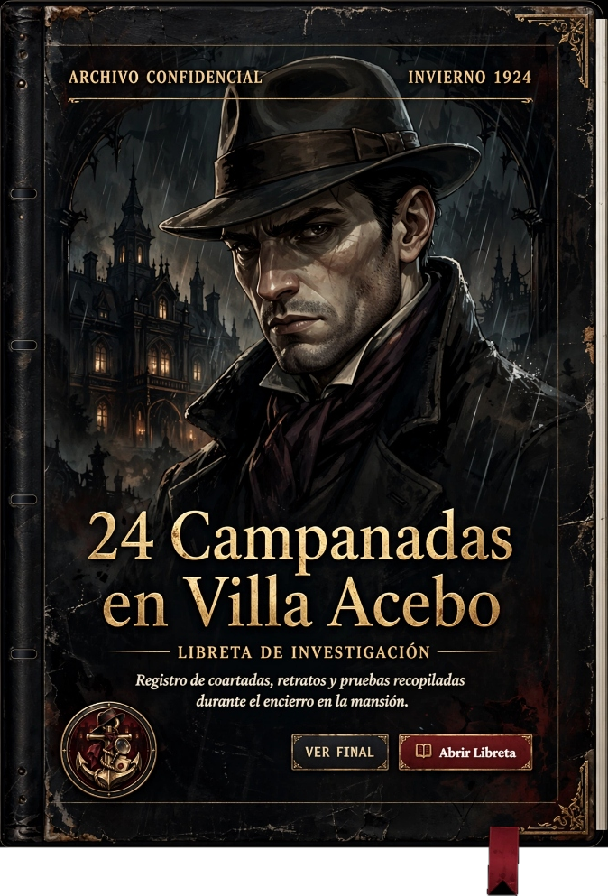
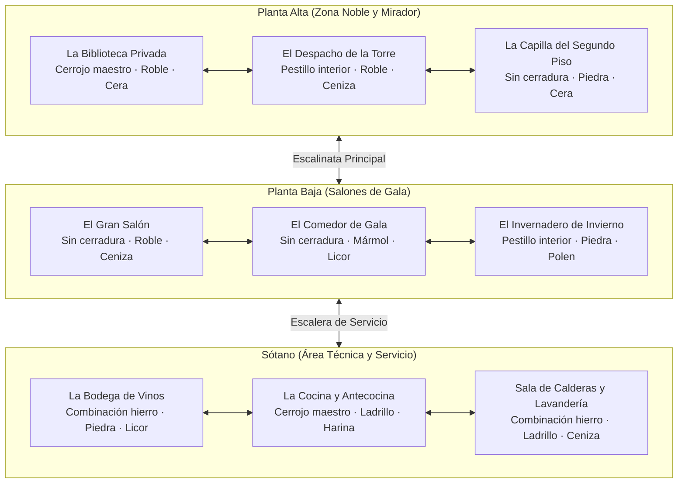
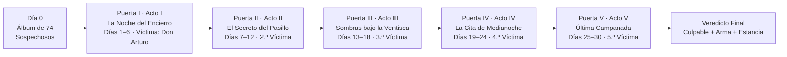
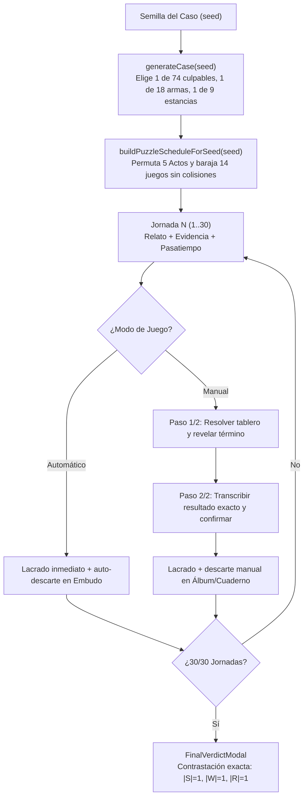
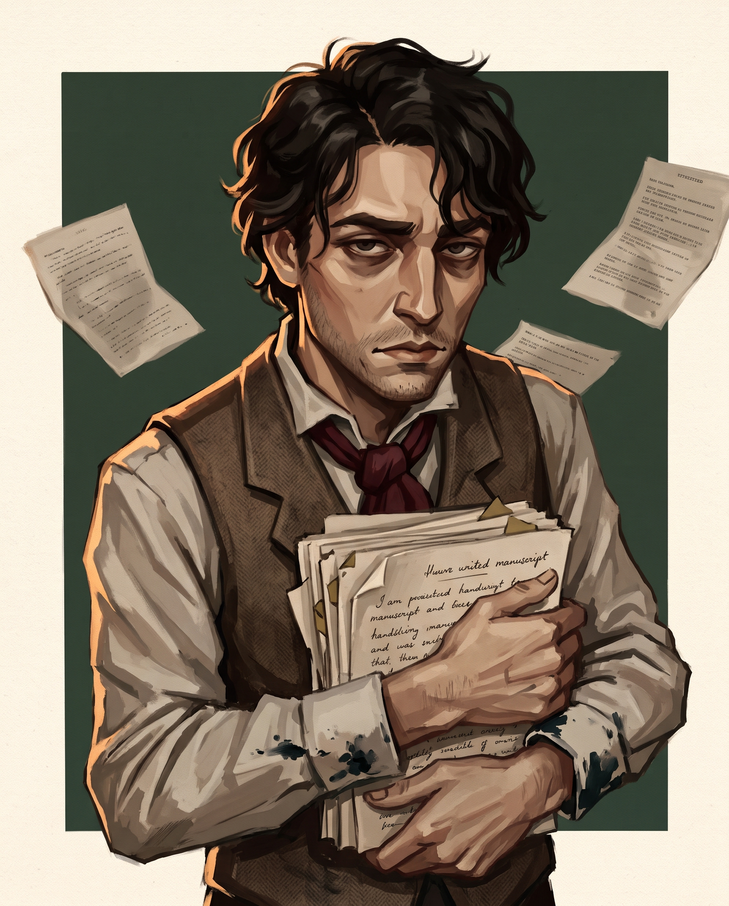
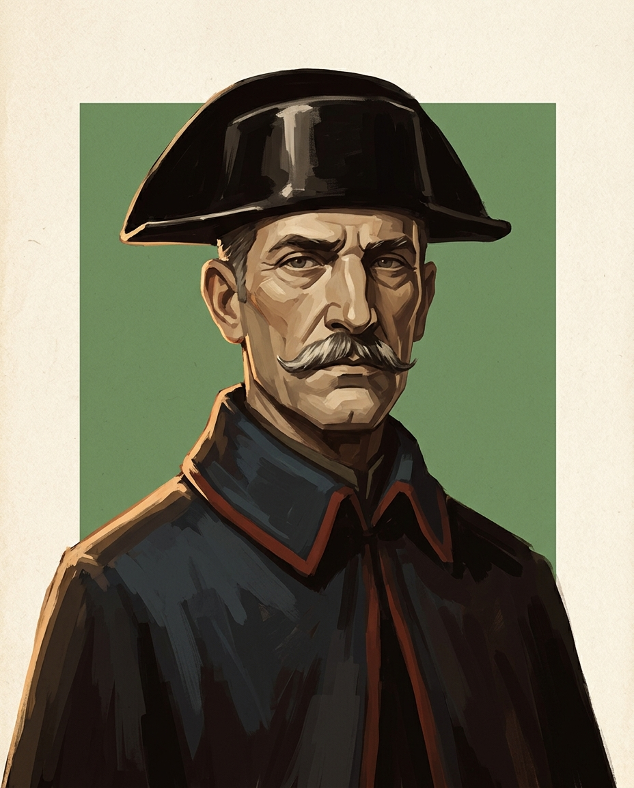
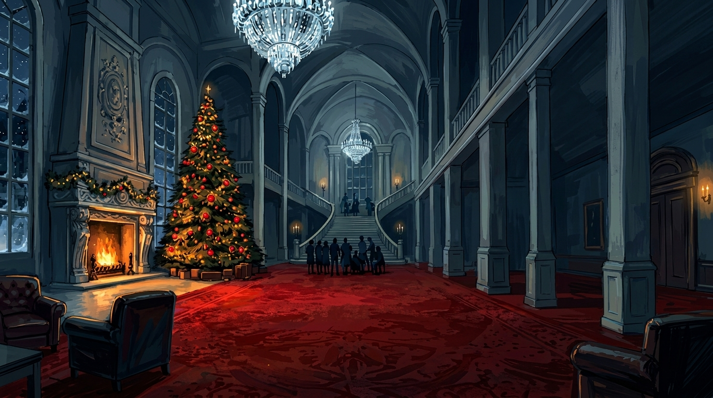
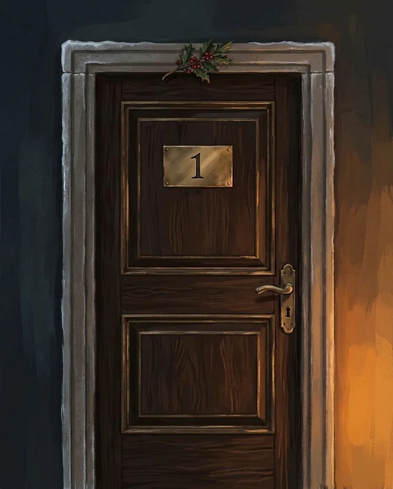
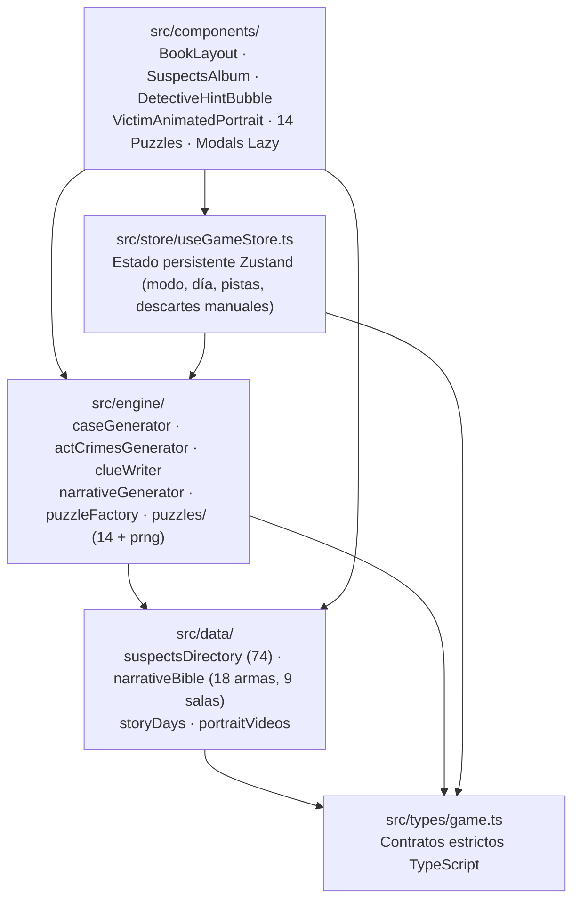

<div align="center">



# Villa Acebo: Un Asesinato en Navidad (Invierno 1924)

**Novela negra interactiva, motor combinatorio determinista de 74 rutas únicas y 14 mecánicas de pasatiempos lógicos en una edición artesanal de 30 jornadas.**

[](https://github.com/Luics415/Invierno-1924/actions/workflows/deploy-pages.yml)


**[Abrir Demo en Vivo (GitHub Pages)](https://luics415.github.io/Invierno-1924/)** · **[Arquitectura](#arquitectura-del-sistema)** · **[Mapa de Villa Acebo](#mapa-de-la-mansi%C3%B3n-y-las-5-puertas)** · **[Acertijos y Probabilidades](#cat%C3%A1logo-de-14-acertijos-y-probabilidades)** · **[Personajes](#reparto-y-tarjetas-de-personajes)**

</div>

---

## Tabla de Contenidos

1. [Resumen Ejecutivo](#resumen-ejecutivo)
2. [Modos de Investigación (Automático vs. Manual)](#modos-de-investigaci%C3%B3n-autom%C3%A1tico-vs-manual)
3. [Mapa de la Mansión y las 5 Puertas](#mapa-de-la-mansi%C3%B3n-y-las-5-puertas)
4. [Flujo de Juego y Embudo Deductivo](#flujo-de-juego-y-embudo-deductivo)
5. [Catálogo de 14 Acertijos y Probabilidades](#cat%C3%A1logo-de-14-acertijos-y-probabilidades)
6. [Motor Paranormal y Probabilidades Ambientales](#motor-paranormal-y-probabilidades-ambientales)
7. [Reparto y Tarjetas de Personajes](#reparto-y-tarjetas-de-personajes)
8. [Galería Visual y Vistas del Proyecto](#galer%C3%ADa-visual-y-vistas-del-proyecto)
9. [Arquitectura del Sistema](#arquitectura-del-sistema)
10. [Planeación y Hoja de Ruta (v0.1 – v1.0)](#planeaci%C3%B3n-y-hoja-de-ruta-v01--v10)
11. [Instalación, Pruebas y Despliegue CI/CD](#instalaci%C3%B3n-pruebas-y-despliegue-cicd)

---

## Resumen Ejecutivo

En la víspera de Navidad de **1924**, una ventisca aísla **Villa Acebo** durante la lectura testamentaria de **Don Arturo Valdemar** (68 años), magnate dueño de tierras, minas, ferrocarriles y editorial. A las **23:15 h**, tras un apagón de cinco minutos, aparece asesinado. La detective **Azlynn** dispone de **30 jornadas** (divididas en **5 Actos** con **5 Puertas** cronológicas) para resolver quién lo mató, con qué arma y en qué estancia.

| Métrica del Motor | Valor Verificado | Garantía Técnica |
| --- | --- | --- |
| **Sospechosos** | **74** personajes (`12` Familia · `18` Invitados · `24` Servicio · `20` Valle) | Atributos, coartada, motivo y retrato único |
| **Armas inventariadas** | **18** armas (`contundente`, `punzante`, `estrangulamiento`, `veneno`) | Patrón lesivo, material y rastro forense |
| **Estancias** | **9** habitaciones en **3** plantas | Cerradura, superficie y rastro ambiental |
| **Combinaciones posibles** | **11,988** (`74 × 18 × 9`) | Generación determinista por semilla (`PRNG mulberry32`) |
| **Rutas únicas garantizadas** | **74 / 74** rutas válidas | Verificado por tests: `\|S\|=1, \|W\|=1, \|R\|=1` sin empates |
| **Juegos / Pasatiempos** | **14** mecánicas distintas en **30** días | Barajado por acto sin repetición consecutiva |
| **Diseño Responsivo** | Escritorio (`>=1024px`), Tablet, Celular Vertical y Horizontal (`2 cols`) | Auditoría en vivo en Chrome + doble pliego en horizontal |

---

## Modos de Investigación (Automático vs. Manual)

Al iniciar partida en `GameModeModal`, el jugador elige su nivel de exigencia. La elección queda **bloqueada durante todo el caso activo** hasta iniciar un *Nuevo Caso* o reiniciar.

| Capacidad | Modo Automático | Modo Manual |
| --- | --- | --- |
| **Inicio con libreta cerrada** | Sí (portada 3D interactiva) | Sí (portada 3D interactiva) |
| **Validación al completar tablero** | Lacra el día y desbloquea la pista al instante | **Paso 1/2:** revela la clave en tablero; **Paso 2/2:** exige escribir y confirmar manualmente el resultado |
| **Descarte de sospechosos (`74`)** | Automático según pistas | **100% manual** en el Álbum / Cuaderno (excepto víctimas mortales de Puertas 2–5, que se tachan automáticamente en ambos modos) |
| **Descarte de armas (`18`) y estancias (`9`)** | Automático según pistas | **100% manual** en el Cuaderno del Detective |
| **Pistas interactivas de Azlynn** | Disponibles en menú radial 3D | Ocultas para preservar el reto deductivo puro |

---

## Mapa de la Mansión y las 5 Puertas

### Plano Arquitectónico de Villa Acebo (3 Plantas × 9 Estancias)



### Mapa de Progresión en 5 Actos y 5 Puertas (`30 Jornadas`)



---

## Flujo de Juego y Embudo Deductivo

Las **30 pistas** siguen `CLUE_SCHEDULE`: **18 pistas de Sospechoso (`60.0%`)**, **7 de Arma (`23.3%`)** y **5 de Estancia (`16.7%`)**. La última pista de cada dimensión cierra la terna exacta sin colapsos prematuros.



---

## Catálogo de 14 Acertijos y Probabilidades

Cada partida distribuye los **14 tipos de juegos** en las **30 jornadas** mediante `buildPuzzleScheduleForSeed(seed)`:
- **12 mecánicas** aparecen exactamente **2 veces** por partida (**`6.67%`** de las jornadas cada una).
- **2 mecánicas** (`Codificados` y `Encajados`) aparecen **3 veces** por partida (**`10.00%`** de las jornadas cada una).
- **Restricciones deterministas:** `0` repeticiones consecutivas entre días o fronteras de acto; `Nonograma` se asigna siempre a días de Arma (`W`) o Estancia (`R`); `Buscaminas` prioriza días de Estancia (`R`).

| # | Mecánica | Motor (`src/engine/puzzles/`) | Apariciones / Caso | Probabilidad por Jornada | Restricción / Especialidad |
| :-: | --- | --- | :-: | :-: | --- |
| 1 | **Sopa de Letras** | `wordsearch.ts` | 2 / 30 | `6.67%` | Localiza términos forenses; las letras sobrantes revelan la clave |
| 2 | **Codificados** | `codificados.ts` | **3 / 30** | **`10.00%`** | Descifrado de claves alfanuméricas de telegramas y registros |
| 3 | **Septagrama** | `septagrama.ts` | 2 / 30 | `6.67%` | Estrella heurística de 7 nodos con palabras encadenadas |
| 4 | **Sudoku 9×9** | `sudoku.ts` | 2 / 30 | `6.67%` | Cuadrícula clásica 9×9 con casillas sombreadas clave |
| 5 | **Encajados** | `encajados.ts` | **3 / 30** | **`10.00%`** | Encaje lógico de bloques y palabras del sumario |
| 6 | **Crucigrama Forense** | `crossword.ts` | 2 / 30 | `6.67%` | Cruce horizontal/vertical con teclado táctil integrado en móvil |
| 7 | **Palabras Clave (Sílabas)** | `syllables.ts` | 2 / 30 | `6.67%` | Reconstrucción silábica de términos probatorios |
| 8 | **Criptograma** | `cryptogram.ts` | 2 / 30 | `6.67%` | Sustitución numérica consistente de frases testimoniales |
| 9 | **Nonograma** | `nonogram.ts` | 2 / 30 | `6.67%` | Silueta lógica; forzado en días de **Arma (`W`) o Estancia (`R`)** |
| 10 | **Murdoku** | `murdoku.ts` | 2 / 30 | `6.67%` | Matriz lógica deductiva de coartadas y ubicaciones |
| 11 | **Conexiones** | `connections.ts` | 2 / 30 | `6.67%` | Agrupación semántica de 16 indicios en 4 categorías |
| 12 | **Futoshiki** | `futoshiki.ts` | 2 / 30 | `6.67%` | Cuadrícula numérica con restricciones de desigualdad (`<`, `>`) |
| 13 | **Ecuaciones Forenses** | `ecuaciones.ts` | 2 / 30 | `6.67%` | Sistemas simbólicos de pesaje, tiempos y dosis |
| 14 | **Buscaminas Táctico** | `minesweeper.ts` | 2 / 30 | `6.67%` | Inspección de plano minado; priorizado en días de **Estancia (`R`)** |

---

## Motor Paranormal y Probabilidades Ambientales

`src/components/ParanormalEngine.tsx` ejecuta un ciclo atmosférico no intrusivo mientras el jugador investiga:
- **Ventana de disparo:** cada suceso ocurre tras un retardo aleatorio uniforme entre **85 y 195 segundos**.
- **Animación `hands-creappy-movie.mp4` (chroma-key en canvas `640px`):**
  - Probabilidad base: **`6.0%`** (`HANDS_TRIGGER_PROBABILITY = 0.06`).
  - **Enfriamiento obligatorio:** mínimo `MIN_NON_HANDS_BETWEEN = 3` sucesos ambientales previos entre apariciones (e inicio protegido con `eventsSinceLastHands = 1`).
- **Sucesos ambientales (`94.0%` cuando hay elegibilidad / `100%` durante enfriamiento):** repartidos equitativamente entre `flicker` (parpadeo de luz), `glass` (cristal), `creak` (madera), `whisper` (susurro) y `breathing` (respiración) — **`18.8%`** cada uno fuera de enfriamiento (**`20.0%`** en enfriamiento).

---

## Reparto y Tarjetas de Personajes

<table>
  <tr>
    <td align="center" width="220">
      <br/>
      <strong>Don Arturo Valdemar</strong><br/>
      <sub><b>Víctima Principal · 68 años</b></sub><br/>
      <sub>Patriarca y magnate absoluto de Villa Acebo. Retrato vivo animado en Prólogo, Álbum y Puerta I.</sub>
    </td>
    <td align="center" width="220">
      <br/>
      <strong>Detective Azlynn</strong><br/>
      <sub><b>Investigadora · 5 estados</b></sub><br/>
      <sub>Medallón 3D interactivo, brújula radial y 17 diálogos dinámicos entre tensión y alivio.</sub>
    </td>
    <td align="center" width="220">
      <br/>
      <strong>#01 Elena Valdemar</strong><br/>
      <sub><b>Familia Valdemar · 42 años</b></sub><br/>
      <sub>Hija mayor y Directora Financiera. Pagarés vencidos y deudas en Montecarlo.</sub>
    </td>
    <td align="center" width="220">
      <br/>
      <strong>#02 Mateo Valdemar</strong><br/>
      <sub><b>Familia Valdemar · 35 años</b></sub><br/>
      <sub>Hijo menor y escritor inédito. Disputa por el manuscrito usurpado en la torre.</sub>
    </td>
  </tr>
  <tr>
    <td align="center" width="220">
      <br/>
      <strong>#13 Dra. Clara Mendoza</strong><br/>
      <sub><b>Invitados de Gala · 50 años</b></sub><br/>
      <sub>Médica personal de Arturo instalada en el gabinete del ala oeste.</sub>
    </td>
    <td align="center" width="220">
      <br/>
      <strong>#18 Barón Klaus Von Berg</strong><br/>
      <sub><b>Invitados de Gala · 63 años</b></sub><br/>
      <sub>Aristócrata prusiano coleccionista de armas antiguas y relojería.</sub>
    </td>
    <td align="center" width="220">
      <br/>
      <strong>#31 Julián Sosa</strong><br/>
      <sub><b>Servicio de la Mansión · 58 años</b></sub><br/>
      <sub>Mayordomo jefe con 30 años de servicio y custodia de llaves maestras.</sub>
    </td>
    <td align="center" width="220">
      <br/>
      <strong>#55 Sargento Román Díaz</strong><br/>
      <sub><b>Habitantes del Valle · 52 años</b></sub><br/>
      <sub>Comandante de la Guardia Civil aislado en Villa Acebo tras el aviso previo.</sub>
    </td>
  </tr>
</table>

> Los **74 sospechosos** cuentan con retrato ilustrado propio (`01-elena.png` a `74-roque.png`), ficha Kodak Velox 1924 volteable en 3D al reverso y **20+ retratos animados `.mp4`** al pasar el cursor o abrir su expediente.

---

## Galería Visual y Vistas del Proyecto

<table>
  <tr>
    <td align="center" width="33%">
      <br/>
      <sub><b>Escenario: Gran Salón (1924)</b> · Iluminación fría de tormenta y chimenea</sub>
    </td>
    <td align="center" width="33%">
      <br/>
      <sub><b>Puerta I: La Noche del Encierro</b> · Apertura física integrada en el libro</sub>
    </td>
    <td align="center" width="33%">
      <br/>
      <sub><b>Escena Forense: La Biblioteca</b> · Placa probatoria de los expedientes por acto</sub>
    </td>
  </tr>
</table>

---

## Arquitectura del Sistema



```text
Un Asesinato en Navidad/
├── public/portraits/          # 74 retratos, 24+ videos .mp4, 5 Puertas, 18 armas, 18 escenas y fondos
├── src/
│   ├── components/            # Libro 3D, Álbum unificado móvil/escritorio, Azlynn 3D, modales lazy y 14 puzzles
│   ├── data/                  # Biblia narrativa, 74 sospechosos, textos de jornadas y videos
│   ├── engine/                # Generador determinista, 14 motores de acertijos, pistas y actos
│   ├── store/                 # Zustand con persistencia y bloqueo de modo por partida
│   ├── types/                 # Interfaces y contratos TypeScript
│   └── utils/                 # Web Audio procedural (soundEffects.ts) y utilidades
├── tests/                     # 288 pruebas unitarias y de aceptación (Tiers 1–4 + Release 1.0)
├── tests/e2e/                 # 83 pruebas E2E del Modo Manual, 74 rutas y reglas de interfaz
└── .github/workflows/         # deploy-pages.yml (CI + despliegue automático a GitHub Pages)
```

---

## Planeación y Hoja de Ruta (v0.1 – v1.0)

| Fase | Alcance Entregado | Estado |
| --- | --- | :-: |
| **Fase 1 — Motor Combinatorio** | Universo `74 × 18 × 9`, `CLUE_SCHEDULE` de 30 jornadas y prueba matemática de 74 rutas únicas sin empates | Completado |
| **Fase 2 — 14 Mecánicas Integradas** | Sopa, Codificados, Septagrama, Sudoku, Encajados, Crucigrama, Sílabas, Criptograma, Nonograma, Murdoku, Conexiones, Futoshiki, Ecuaciones y Buscaminas con barajado determinista por semilla | Completado |
| **Fase 3 — Modo Manual Estricto** | Doble verificación tablero + transcripción escrita, descarte manual independiente de 74 sospechosos / 18 armas / 9 estancias y auto-tachado protegido de víctimas | Completado |
| **Fase 4 — Inmersión y Release 1.0** | Libro cerrado inicial, perfil y retrato animado de Don Arturo Valdemar (`68 años`), Azlynn 3D con 17 diálogos, teclado táctil de crucigrama y probabilidad paranormal al `6%` | Completado |
| **Fase 5 — Auditoría Responsiva Chrome** | Scroll libre inferior sin recortes en móvil vertical, Álbum unificado, doble pliego `50%/50%` fiel al escritorio en celular horizontal (`280–340px`) y tablet equilibrada | Completado |

---

## Instalación, Pruebas y Despliegue CI/CD

### Requisitos y ejecución local
- **Node.js 20+** y **npm**.

```bash
npm ci
npm run dev
```

### Comandos y verificación de calidad

| Comando | Descripción | Último Resultado Verificado |
| --- | --- | --- |
| `npm test` | Suite unitaria y de aceptación (`tests/`) | **288 / 288** aprobadas (`11` archivos) |
| `npx vitest run --config vitest.e2e.config.ts` | Suite E2E de Modo Manual y 74 rutas | **83 / 83** aprobadas |
| `npm run lint` | Análisis estático con `oxlint` | **0 warnings, 0 errors** (`77` archivos) |
| `npm run build` | Verificación `tsc -b` + bundle `vite build` con code splitting | Exitoso en `~2.3 s` |

### Despliegue automático
Cada push a `main` dispara `.github/workflows/deploy-pages.yml`, que instala con `npm ci`, ejecuta `npm test`, compila `dist/` con rutas relativas (`base: './'` y `cssTarget: 'chrome90'`) y publica en **https://luics415.github.io/Invierno-1924/**.
